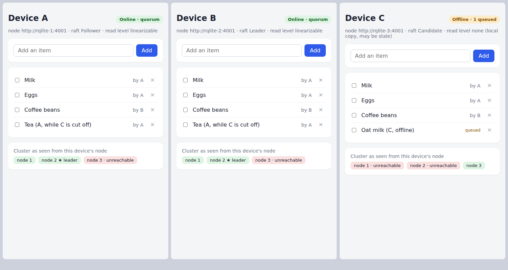
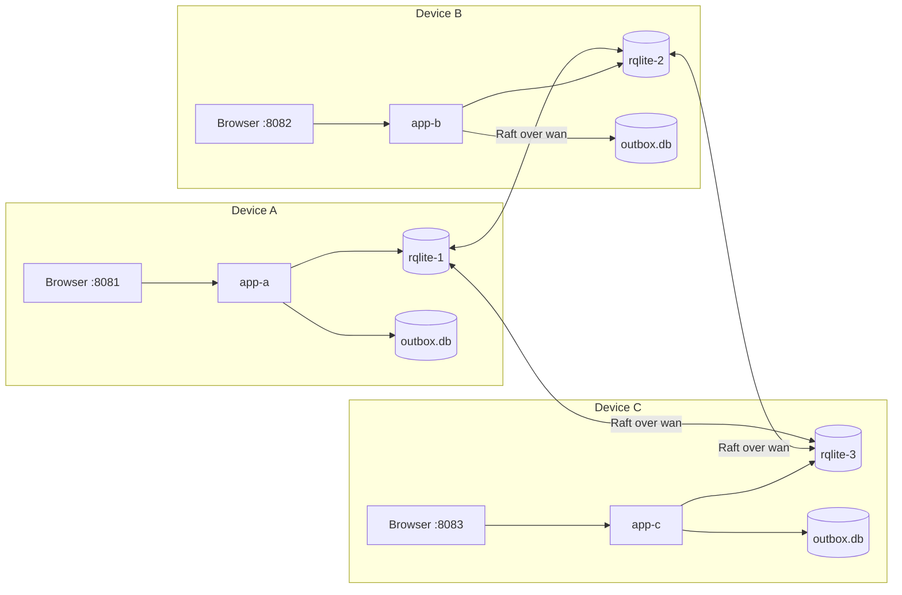
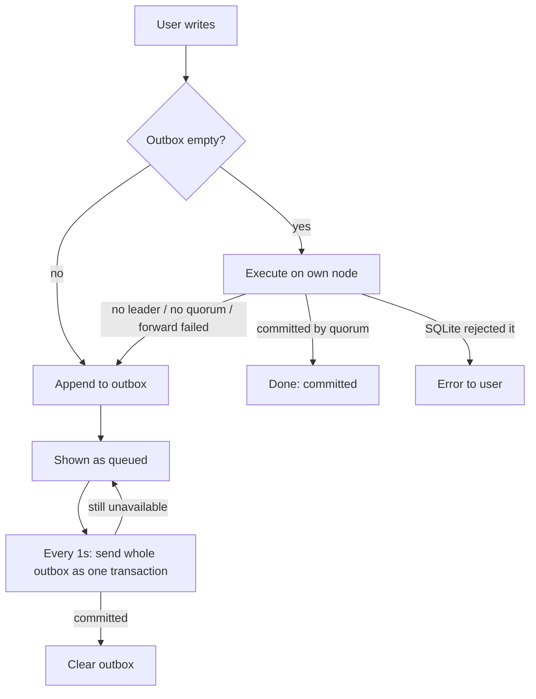

# rqlite-local-first

A shared checklist on three "devices" backed by a three-node [rqlite](https://github.com/rqlite/rqlite) cluster.
Write on one device, see it on the others.
Cut a device off, keep writing, heal it, watch it converge.

The point is to show where rqlite fits a local-first app and where it does not.



## Why rqlite here

rqlite is SQLite replicated with Raft.
Every node keeps a full SQLite copy on its own disk.
A write commits once a majority of nodes has it.

For a local-first app that buys three things:

- **Local data.** Each device runs its own node and reads its own SQLite file. Reads keep working when the device is cut off.
- **Plain SQL.** The schema is one `CREATE TABLE`. No CRDT types, no merge functions.
- **One agreed order.** Any device that can reach a quorum reads the same, latest state. No "eventually".

It does not buy offline writes.
A node without a quorum cannot commit anything.
Classic local-first tools (Automerge, Yjs, cr-sqlite, Electric) accept writes anywhere and merge later.
rqlite refuses instead.

This demo bridges that gap with a small outbox.
It is honest about what the outbox costs (see [Tradeoffs](#tradeoffs)).

## Architecture



- Each device is one rqlite node plus one small Go app ([app/](app/)) on a private network.
- The rqlite nodes talk to each other only over the `wan` network. Disconnecting a node from `wan` simulates a device losing its uplink.
- The app talks only to its own node. A follower forwards writes to the leader.
- `outbox.db` is a plain local SQLite file in the app. It holds writes the cluster could not commit.

### Write path



A new write queues behind older queued writes, so one device's writes commit in the order the user made them.
Item ids are UUIDs minted on the device, and every op is idempotent (`INSERT OR IGNORE`, `UPDATE ... SET done = ?`, `DELETE`).
A write that timed out but committed anyway does no harm when the outbox replays it.

### Read path

The app first asks for a `linearizable` read.
That only succeeds if its node can reach a leader backed by a quorum, so success means the device is online.
Otherwise it reads its node's local copy with `level=none` (possibly stale) and lays the queued ops on top.
The badge shows which one you are looking at.

## Run it

Needs Docker with Compose v2, and `jq` for the scripted demo.

```sh
git clone https://github.com/IniZio/rqlite-local-first
cd rqlite-local-first
make up        # docker compose up -d --build
```

Open the three devices side by side:

| Device | URL |
| --- | --- |
| A | http://localhost:8081 |
| B | http://localhost:8082 |
| C | http://localhost:8083 |

All ports bind to `127.0.0.1` only.
`make down` stops everything and deletes the volumes.

## What to try

| Do this | Expect |
| --- | --- |
| Add an item on A | It shows up on B and C within a second. |
| `docker compose stop rqlite-2` | A and C stay online. 2 of 3 is still a majority. B shows "unreachable" because its own node is gone. |
| Write on A or C, then `docker compose start rqlite-2` | Node 2 replays the Raft log and B shows the new items. |
| `make isolate DEVICE=c` | C turns amber: "Offline · N queued". C still shows its last-known list. |
| Write on A and on C | A's write commits. C's write is marked "queued". Neither sees the other's write. |
| `make heal DEVICE=c` | C rejoins, receives A's write, drains its outbox. All three converge. |
| `docker compose stop rqlite-2 rqlite-3` | A is alone. It has a full copy but no quorum, so it goes offline and queues. |
| `docker compose start rqlite-2 rqlite-3` | Quorum returns and A drains. |
| Kill the leader (see the ★ in the cluster panel) | Remaining nodes elect a new leader within a few seconds. |

`make demo` runs all of this as a script and asserts each step.
It expects a running cluster.

Poke at the database directly with the rqlite shell inside any node:

```sh
docker compose exec rqlite-1 rqlite
127.0.0.1:4001> SELECT * FROM items;
127.0.0.1:4001> .nodes
```

## Tradeoffs

**Good fit.**
A handful of nodes that are usually connected.
Think shop tills, a clinic's machines, edge boxes in a factory, or a small team's servers.
You want every node to read locally and fast, survive one node dying, and never argue about which write won.

**Poor fit.**
Phones and laptops that go offline for hours.

- **A lone node cannot commit.** Raft needs a majority. Picture three devices where one loses its uplink. That one cannot commit until it reconnects. The outbox hides this from the user but does not change it.
- **Queued writes are last-writer-wins by arrival.** When C reconnects, its queued `UPDATE` applies after everything the others committed meanwhile. If C ticked an item while offline and A unticked it later, C's older tick wins. A CRDT would merge by causality instead.
- **Stale reads while offline.** C shows its last-known list plus its own queued writes. It does not see the others' writes until it reconnects.
- **Every device is a voter.** Adding a fourth, flaky device to a three-node cluster raises the quorum to 3 of 4. Flaky devices should join as [read-only (non-voting) nodes](https://rqlite.io/docs/clustering/read-only-nodes/) instead.
- **Writes cost a round trip to the leader.** Over a slow WAN that is tens to hundreds of milliseconds per commit.

**When to pick something else.**
If offline editing on a single device is the main use case, use a CRDT store (Automerge, Yjs, cr-sqlite) and sync it.
To keep rqlite in that setting, treat queued ops as intents with app-level conflict rules. Do not replay them as raw SQL.

## Layout

- [compose.yaml](compose.yaml) wires three nodes, three apps and the networks.
- [app/](app/) is the Go app and its single-page UI.
- [scripts/net.sh](scripts/net.sh) cuts or heals one device's `wan` link.
- [scripts/demo.sh](scripts/demo.sh) is the scripted walkthrough.

## License

MIT
